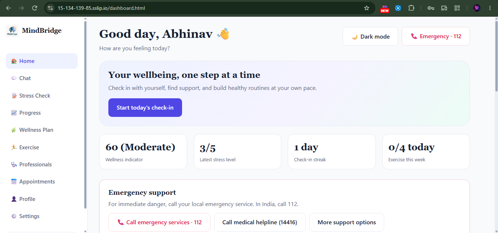
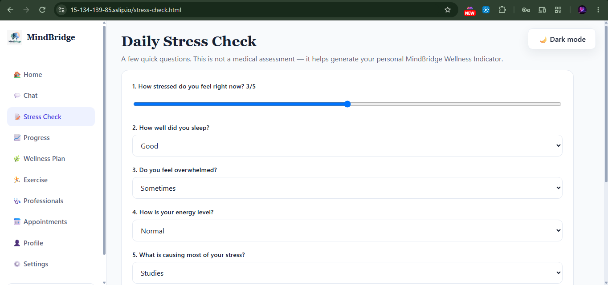
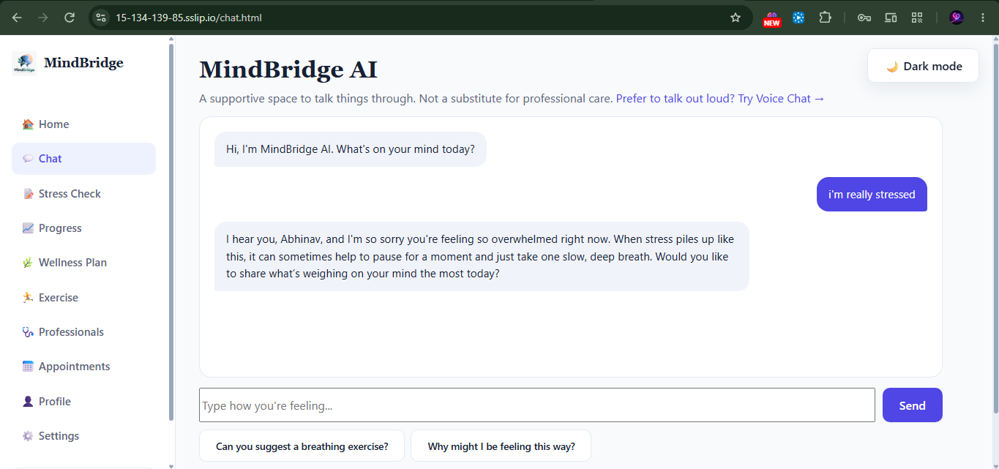
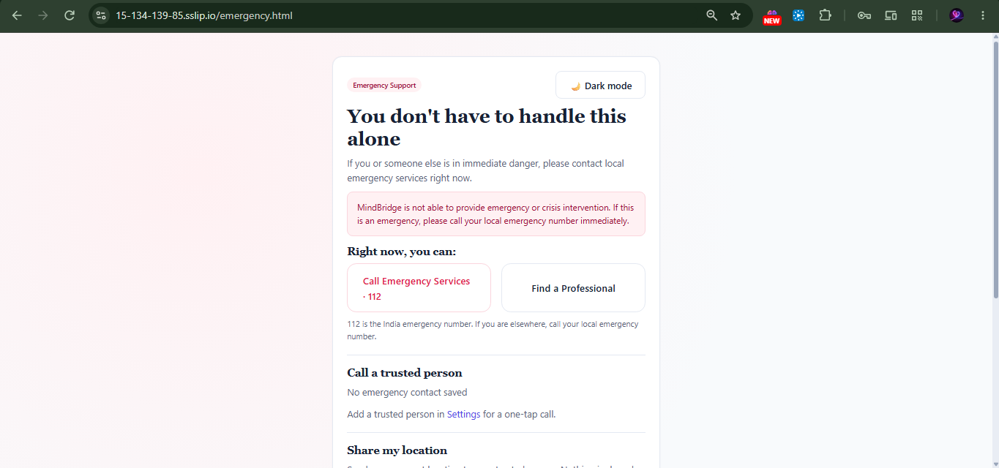
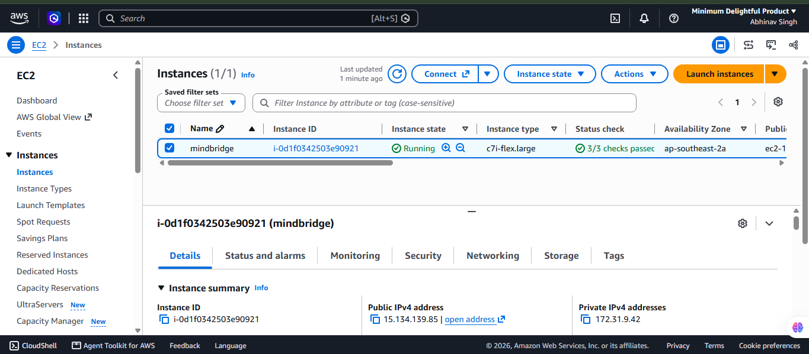

# MindBridge

An AI-assisted mental health check-in platform for students and working professionals. It screens and supports. It does not diagnose.

**Live project:** https://15-134-139-85.sslip.io
**Team:** Aabir Paul (presentation and planning), Aniket Kushwaha (frontend), Abhinav Singh (backend) 

## Problem
Students and professionals face stress and burnout, but often have no private, early way to check in or to know when to seek professional help.

## Key features
- Account signup and login (hashed passwords, token-based auth)
- Daily stress check-in with a wellness score and band (Low, Moderate, Elevated, High)
- AI chat (Gemini) with a crisis-keyword safety layer that links to emergency support
- Optional signals that can lower the score by small capped amounts: face expression (DeepFace), speech pace and pauses, and a Gemini read of chat text
- Dashboard and progress charts, wellness plan, exercise reminders
- Professional listing and appointment booking (demo data)
- One-tap location sharing to a saved trusted contact, emergency contacts, dark mode

## Tech stack
Python, FastAPI, PostgreSQL (SQLAlchemy), Gemini API, DeepFace, NumPy, HTML/CSS/JavaScript, Chart.js. Deployed on AWS (EC2, CloudFront), with nginx and systemd.

## Implementation details
- The wellness score is a weighted formula over seven check-in answers, not a trained model. The ML parts are the pretrained DeepFace emotion model and Gemini.
- Face, voice and text signals can only lower the score (by at most 10, 5 and 5 points), and only when recorded in the last 30 minutes. These weights are design choices, not clinically validated.
- Photos and audio are analyzed in memory and never stored. Only the resulting numbers are saved.
- Passwords are bcrypt-hashed. Private routes need a signed token.

## AWS deployment
- Region: Asia Pacific (Sydney)
- Amazon EC2 (Ubuntu, YOUR-INSTANCE-TYPE) runs nginx (static frontend and `/api` reverse proxy), the FastAPI backend as a systemd service, and PostgreSQL
- HTTPS: Let's Encrypt certificate issued with certbot on nginx, served from the sslip.io hostname for the instance's public IP
- Face analysis is turned off in the deployed build (`FACE_ENABLED=false`) because the free-tier server is too small to run TensorFlow. The code is in the repo and works locally.
- Live link: https://15-134-139-85.sslip.io

## Setup and usage (local)
1. `git clone https://github.com/DareDevil317/MindBridge.git && cd MindBridge`
2. `python -m venv venv`, activate it, then `pip install -r requirements.txt` (optional face scan: `pip install -r requirements-face.txt`, needs Python 3.10 to 3.13)
3. Create a PostgreSQL database named `mindbridge`, copy `.env.example` to `.env`, and fill in the database URL, a secret key and a Gemini API key
4. Start the backend: `uvicorn main:app`
5. In another terminal: `cd Frontend && python -m http.server 5500`, then open http://127.0.0.1:5500/index.html
6. Sign up, take a stress check, and try the chat

## Limitations
Chat history, wellness plans and reminders are in memory and reset on restart. Professionals and appointments use demo data. Not a medical device and not for emergencies.

## Screenshots

